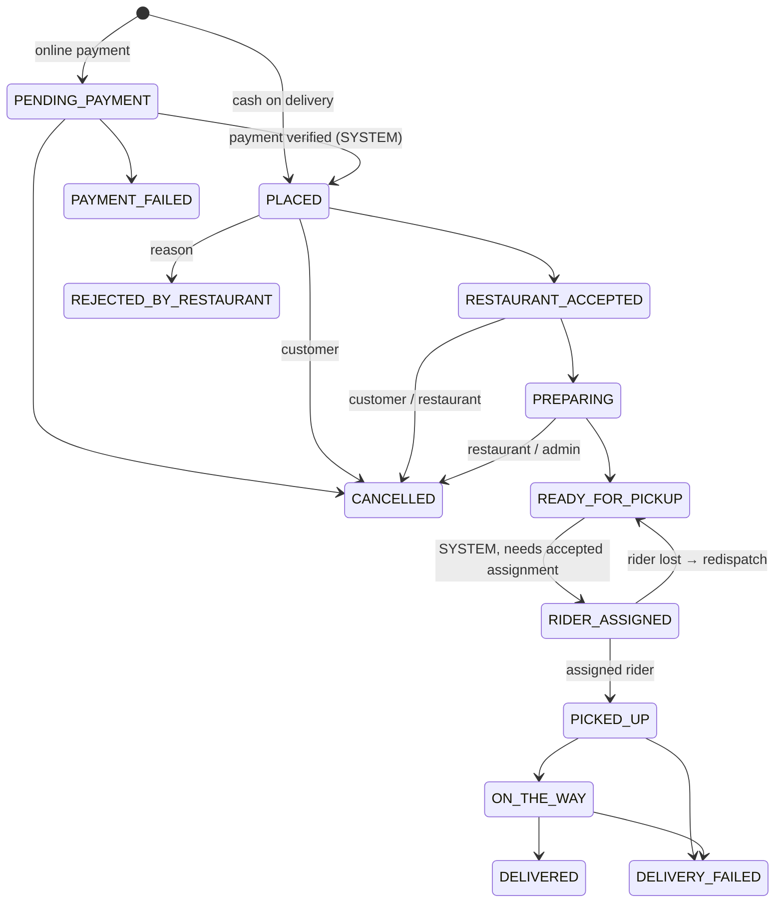

# FoodFlow: Phase 1 Architecture

## 1. Shape of the system

```
 Next.js (Vercel) ──HTTPS/REST──►  Express API ──► PostgreSQL + PostGIS   (source of truth)
        │                              │  ├────► Redis  (rate-limit store, Socket.IO adapter, BullMQ, rider live position)
        └──────WebSocket (Socket.IO)───┘  └────► Object storage (Cloudinary / S3) · Maps/Directions · Payment provider
```
Modular monolith on **Express 5 + TypeScript** with no framework magic: plain classes wired by hand in one composition root (`src/container.ts`), plain routers, zod validation. One deployable with strict module boundaries (below), so a module can be extracted later without a rewrite.
`frontend/` and `backend/` are fully independent projects; the only contract between them is the HTTP/Socket API.

## 2. Backend modules

| Module | Responsibility | Phase |
|---|---|---|
| `config` | zod-validated environment, fails fast at boot | 2 ✅ |
| `prisma`, `audit`, `mail` | DB access, audit trail, mail adapter (dev adapter only) | 2 ✅ |
| `auth` | register / login / refresh-rotation / logout / password reset | 2 ✅ |
| `users` | `/users/me` profile (addresses next) | 2 ✅ |
| `orders` | state machine + the single transition service | 1 ✅ |
| `settings` | cached platform settings with code defaults | 3 ✅ |
| `addresses` | customer address book | 3 ✅ |
| `discovery` | PostGIS nearby + zone eligibility + ranking; public restaurant/menu read | 3 ✅ |
| `cart`, `checkout`, `orders` (customer side) | server-priced totals, coupons, idempotent order creation, history, cancel | 3 ✅ |
| `restaurants` (owner profile/hours/zones/menu/kitchen orders/stats) | owner-scoped; ownership checked on every call | 4 ✅ |
| `admin` (restaurant approval, commission) | state-machine + readiness gate, audit in the same transaction | 4 ✅ |
| `riders`, `dispatch` | rider onboarding/verification, one-at-a-time offers, concurrency-safe accept/release, expiry sweep, admin intervention | 5 ✅ |
| `realtime`, `notifications` | Socket.IO gateway; order chat; live tracking; in-app notifications with transactional outbox (`LISTEN/NOTIFY`) | 6 ✅ |
| `payments` | COD + gateway adapter, verified idempotent callbacks, refunds, earnings, payouts, reconciliation | 7 ✅ |
| `reviews`, `promotions`, `support`, `admin` (users, stats, audit, settings, service areas) | | 7 ✅ |

## 3. Request pipeline
`request-id + pino logging → helmet → CORS allow-list → JSON body (100 kB) → cookies → global rate limit → router → 404 → error handler`

* Everything under `/api/v1` is **private by default**: public routers (`/auth`, `/restaurants`, `/cuisines`) are mounted explicitly; every other router sits behind `authenticate` (→ 401) and then `requireRole(...)` (→ 403). See `src/http/app.ts`.
* `authenticate` verifies the JWT *and* re-loads user + session from the DB on every request. Role, suspension and logout take effect immediately. Role is never read from the token.
* `requireRole` is coarse-grained. **Object-level checks** (does this order belong to this customer? does this owner own that restaurant?) live in the services, never in the frontend. A resource that is not yours is a 404, not a 403.
* Input is validated by **strict zod schemas** (`src/schemas/*`): unknown fields are rejected (a client-sent `price` or `commissionBps` is a 400, never silently ignored). Query strings are coerced and range-checked.
* Every error: `{ "error": { "code", "message", "details?", "requestId" } }` (`src/http/middleware.ts`). Unknown errors are logged in full and returned as a generic 500.
* Services never import Express: they take plain arguments and throw `DomainError`. That keeps them testable without HTTP and reusable from jobs and (later) Socket.IO handlers.
* Background work (`src/jobs.ts`) is plain timers: dispatch sweep every 5 s, order accept-timeout every 30 s. Every job locks rows and re-checks state, so running several API instances needs no leader election.

## 4. Authentication design
* Access token: JWT HS256, 15 min, `{ sub, sid }` only. Sent as `Authorization: Bearer`.
* Refresh token: 256-bit opaque value in an **httpOnly, Secure, path-scoped (`/api/v1/auth`) cookie**. Only its SHA-256 is stored.
* **Rotation + reuse detection**: each refresh retires the old session row and issues a new one in the same *family*. Presenting a retired token revokes the whole family (10 s grace window for two-tab races).
* **CSRF**: cookie endpoints (`refresh`, `logout`) require an allow-listed `Origin` (when sent) and `X-Requested-With: FoodFlow`. Combine with `SameSite`.
  *Deployment note:* Vercel + a separate API domain is cross-site → needs `COOKIE_SAMESITE=none; COOKIE_SECURE=true`. Preferred: serve the API under the same registrable domain (e.g. `app.example.com` / `api.example.com`) and keep `lax`.
* Passwords: scrypt (N=2¹⁶, r=8, p=1), parameters stored in the hash, auto-rehash on login. 10–128 chars.
* Brute force: per-route throttles + per-account lockout (5 fails → 15 min). Unknown emails burn the same CPU as known ones.
* Password reset: single-use, 30 min, hashed token, atomic claim, **all sessions revoked** on success. The forgot-password response never reveals whether an email exists.
* `ADMIN` can never be created through the API (seed/ops only).

## 5. Authorization matrix (backend-enforced)

| Capability | Customer | Owner | Rider | Admin |
|---|:-:|:-:|:-:|:-:|
| Browse restaurants / menus | ✅ | ✅ | ✅ | ✅ |
| Create order (own cart only) | ✅ | | | |
| Cancel order | ✅ before `PREPARING`, own | ✅ own restaurant, reason | | ✅ |
| Accept/reject order | | ✅ own restaurant | | ✅ |
| Prepare / mark ready | | ✅ own restaurant | | ✅ |
| Accept/reject delivery offer | | | ✅ approved + online | |
| Pickup / on-the-way / deliver | | | ✅ **assigned rider only** | deliver/fail |
| Read rider location | ✅ own order, while active | | ✅ self | ✅ |
| Order chat (read/send) | ✅ order owner | ❌ | ✅ currently-assigned | ❌ (moderation read-only in a later phase) |
| Approve/suspend restaurants | | ❌ (cannot approve own) | | ✅ |
| Approve/suspend riders, review documents | | | | ✅ |
| Platform settings, coupons (platform), refunds | | | | ✅ |

## 6. Order state machine
Source of truth: `src/orders/order-state-machine.ts` (pure, unit-tested). Only `OrderTransitionService` may write `Order.status`.


**Design decision (please confirm):** your spec lists `RIDER_ASSIGNED` *after* `READY_FOR_PICKUP`, but the end-to-end flow has the rider accept *before* the kitchen finishes. To satisfy both, dispatch starts when the restaurant accepts and is tracked in `DeliveryAssignment`; `RIDER_ASSIGNED` is the join point, entered automatically by the system once the food is ready **and** an assignment is `ACCEPTED`, in either order. Chat is gated on the assignment, not the order status, so the customer can chat with the rider as soon as they accept.

Each transition is one DB transaction: `SELECT … FOR UPDATE` → machine check → ownership check → precondition → update guarded by `version` (optimistic lock) → `OrderStatusHistory` row → on terminal states, settle the live assignment and **close the chat room** (read-only).

**Refunds** are their own lifecycle (`REQUESTED → APPROVED/REJECTED → PROCESSED/FAILED`), not an order status, because a delivered order can still be refunded.

## 7. Key data relationships
```
User 1─1 UserCredential        (secrets isolated)         User 1─1 Profile
User 1─* Session (family)      User 1─* Address           User 1─1 RiderProfile 1─* DeliveryAssignment
User(owner) 1─* Restaurant 1─* MenuCategory 1─* MenuItem 1─* ItemVariant / AddonGroup 1─* Addon
Restaurant 1─* DeliveryZone (radius | polygon)   Restaurant 1─* OperatingHour
Customer 1─* Order *─1 Restaurant          Order 1─1 OrderDeliveryAddress (snapshot)
Order 1─* OrderItem 1─* OrderItemAddon      (immutable snapshots: names + prices)
Order 1─* OrderStatusHistory                Order 1─* DeliveryAssignment 1─* RiderLocationUpdate
Order 1─0..1 OrderChatRoom 1─* ChatMessage  (room exists only after an assignment is ACCEPTED)
Order 1─* Payment 1─* Refund                Order 1─0..1 RestaurantEarning / RiderEarning ─* Payout
Order 1─0..1 Review (unique orderId)        Coupon 1─* CouponRedemption (unique orderId)
```
Integrity beyond Prisma lives in `prisma/sql/001_postgis_and_constraints.sql`:
* one live (`OFFERED|ACCEPTED`) assignment per order → two riders can never hold the same delivery
* one `SUCCESSFUL` payment per order → duplicate callbacks cannot double-credit
* order total = subtotal + fees + tax − discount, ratings 1-5, coordinate ranges, non-negative money
* `(customerId, idempotencyKey)` unique → retried checkout cannot create duplicate orders

Money is **integer minor units** (paisa). Geography columns are generated from `lat/lng` and GiST-indexed.

## 8. Location & chat privacy policy (enforced in Phase 6)
* Live rider position is stored on the rider's profile (for dispatch) and appended to `rider_location_updates` only for the active assignment; positions are rate-limited and plausibility-checked.
* A sweeper deletes trail rows older than `LOCATION_RETENTION_HOURS` (default 24 h).
* Only the order's customer, the assigned rider and admins can subscribe to tracking; sharing stops on terminal state or reassignment.
* Chat history stays readable (read-only) to the two participants for a retention window, and is purged afterwards.

## 9. Directory structure
```
foodflow/
├── backend/
│   ├── prisma/ { schema.prisma, seed.ts, sql/001_postgis_and_constraints.sql }
│   ├── src/
│   │   ├── server.ts · container.ts · jobs.ts      entry point · composition root · timers
│   │   ├── http/          app.ts, middleware.ts, validate.ts, routes/{auth,customer,public,owner,admin,rider}.ts
│   │   ├── schemas/       zod request schemas (one file per area)
│   │   ├── config/ common/ prisma/ audit/ mail/ settings/
│   │   ├── auth/ users/ addresses/ discovery/ cart/ checkout/
│   │   ├── orders/        state machine, transition service, customer order service, accept-timeout job
│   │   ├── restaurants/   owner profile / hours / zones / menu / kitchen orders / stats (+ approval rules)
│   │   ├── riders/ dispatch/   rider onboarding & deliveries · offer engine, accept/release, admin intervention
│   │   └── admin/         restaurant & rider approval, dispatch tools
│   ├── test/              HTTP wiring (DB stubbed), SQL contract tests, real-DB integration + end-to-end suites
│   ├── scripts/           optional WASM test-client builder
│   ├── docs/              ARCHITECTURE.md, API.md
│   └── docker-compose.yml · .env.example
└── frontend/              (separate Next.js project: built after the backend phases)
```
